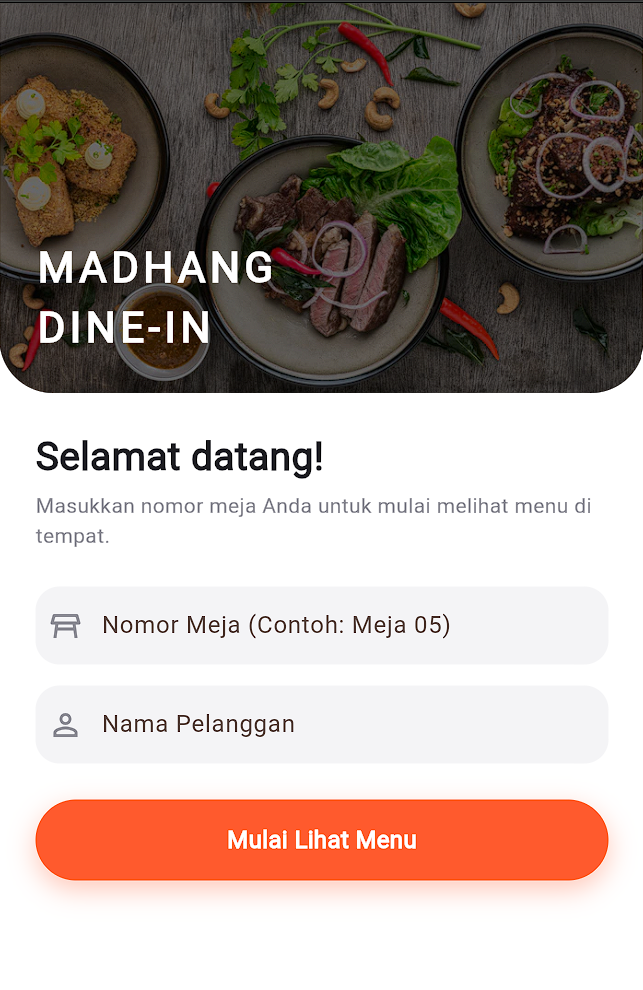
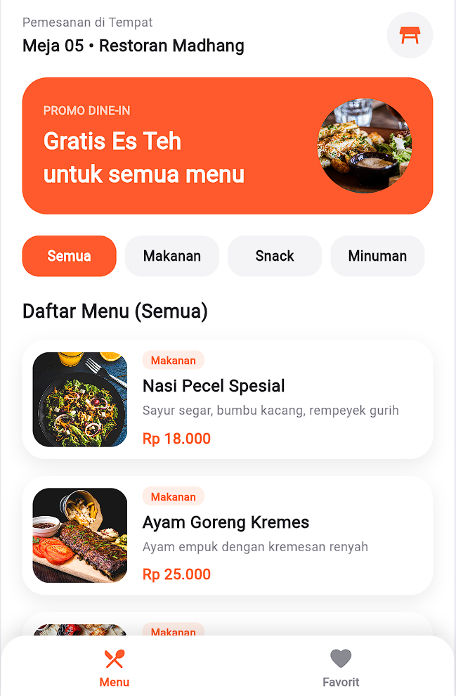
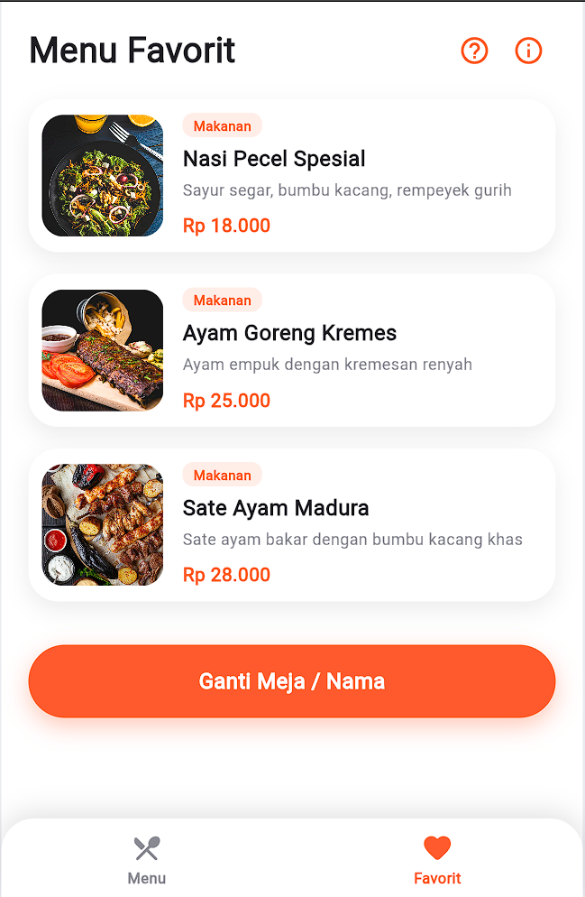
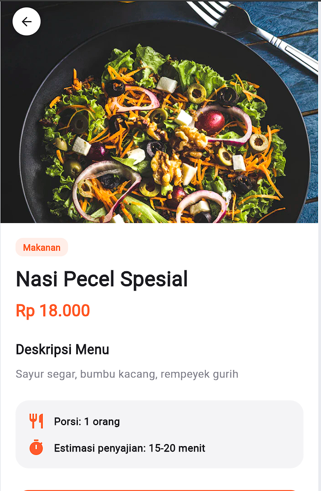
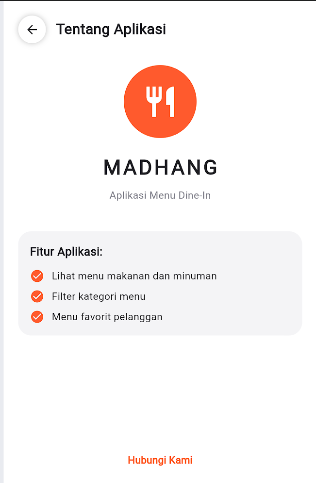
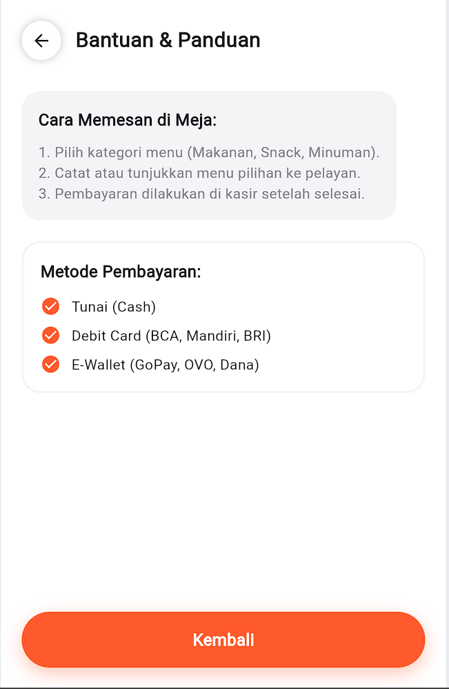
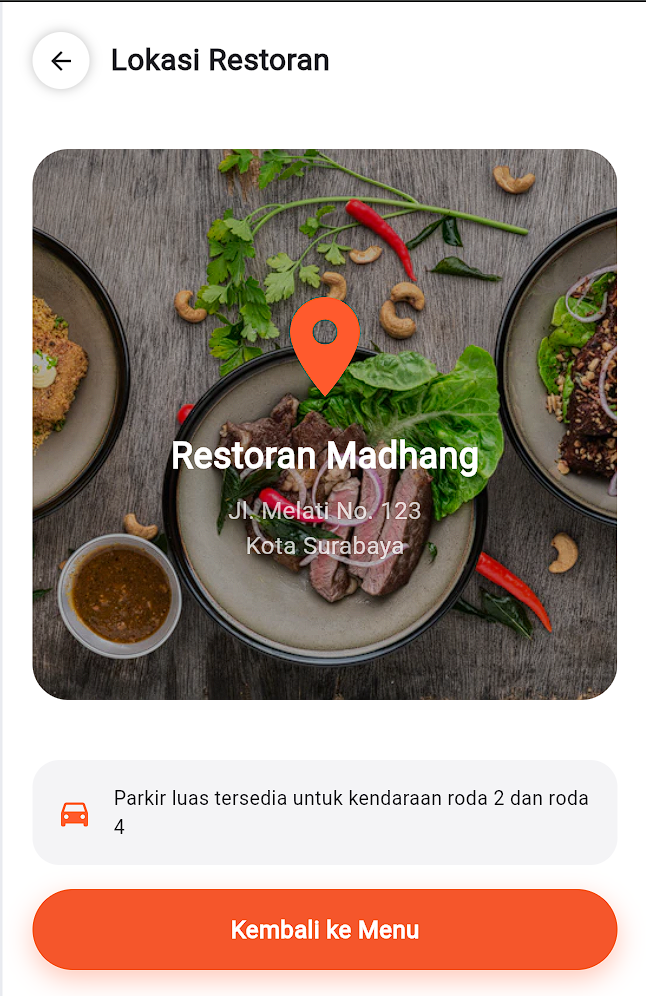
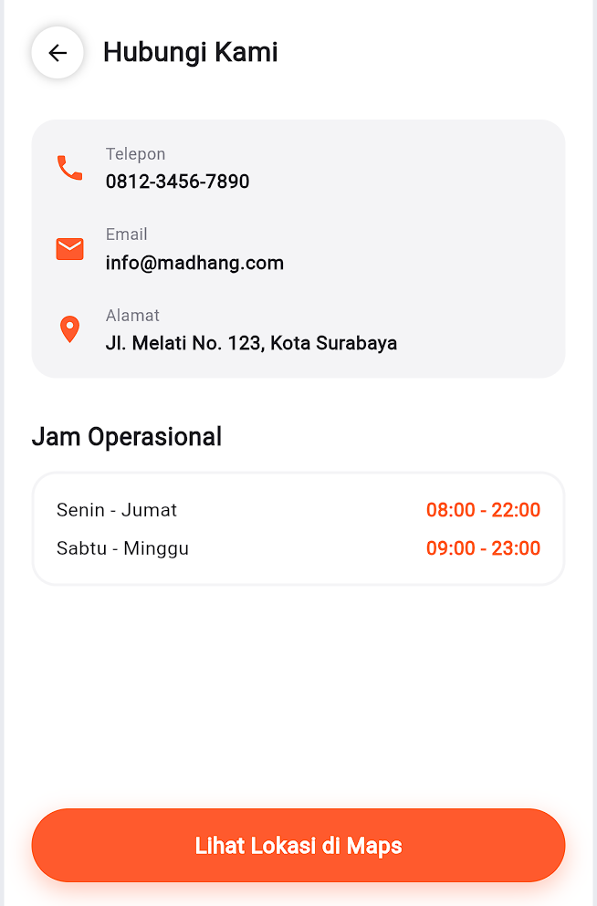

# 📱 MADHANG — Aplikasi Menu Dine-In (Tugas UTS Pemrograman Mobile)

Aplikasi mobile pemesanan makanan di tempat (*dine-in*) berbasis **Flutter** dengan antarmuka yang interaktif, bersih, dan modular.

---

## 📌 Deskripsi Tugas & Fitur

Aplikasi ini dibuat untuk memenuhi tugas Ujian Tengah Semester (UTS) mata kuliah Pemrograman Mobile dengan mengimplementasikan konsep dasar Flutter:
1. **UI Dasar**: Penggunaan `Text`, `TextStyle`, `Icon`, `Color`, dan `Container`.
2. **Layout**: Penyusunan tata letak menggunakan `Row`, `Column`, serta kombinasinya.
3. **Spacing**: Penerapan `Margin`, `Padding`, dan `SizedBox` yang rapi.
4. **Image**: Penggunaan `Image.network` dengan format **WebP** (`fm=webp`) dan `BoxFit.cover`.
5. **Navigation**: 7 Halaman yang saling terhubung menggunakan `Navigator.push()` dan `Navigator.pop()`.

---

## 📂 Struktur Folder Proyek

```
lib/
├── main.dart                     # Entry point aplikasi & konfigurasi tema
├── core/
│   └── constants.dart            # Warna, format Rupiah, dan helper navigasi
├── models/
│   └── food_item.dart            # Model data menu makanan & minuman
├── widgets/
│   └── custom_widgets.dart       # Komponen UI reusable (Photo, OrangeButton, FoodCard, dll)
└── pages/
    ├── login_page.dart           # Halaman 1: Masuk & Input Nomor Meja
    ├── main_shell.dart           # Halaman 2: Menu Utama (Bottom Nav: Menu & Favorit)
    ├── detail_menu_page.dart     # Halaman 3: Detail Lengkap Menu
    ├── about_page.dart           # Halaman 4: Tentang Aplikasi
    ├── contact_page.dart         # Halaman 5: Hubungi Kami & Jam Operasional
    ├── location_page.dart        # Halaman 6: Lokasi Restoran
    └── help_page.dart            # Halaman 7: Bantuan & Metode Pembayaran
```

---

## 🚀 Cara Menjalankan Proyek

1. Pastikan Flutter SDK sudah terinstal di komputer Anda.
2. Clone repository ini:
   ```bash
   git clone https://github.com/Ivannnaff/mobile_uts.git
   cd mobile_uts
   ```
3. Jalankan perintah untuk mengambil dependensi:
   ```bash
   flutter pub get
   ```
4. Jalankan aplikasi (misalnya di Chrome atau Emulator Android):
   ```bash
   flutter run -d chrome
   ```

---

## 🖼️ Screenshot & Keterangan Halaman

| Halaman Login | Dashboard Menu |
|:---:|:---:|
| <br>**Halaman Login:** Input nomor meja dan nama pelanggan saat pertama kali masuk aplikasi. | <br>**Dashboard Menu:** Daftar menu lengkap dengan filter kategori (Makanan, Snack, Minuman). |

| Menu Favorit | Detail Menu |
|:---:|:---:|
| <br>**Menu Favorit:** Menampilkan menu unggulan serta tombol kembali ke halaman login. | <br>**Detail Menu:** Menampilkan foto besar, harga, deskripsi, porsi, dan estimasi penyajian. |

| Tentang Aplikasi | Bantuan & Pembayaran |
|:---:|:---:|
| <br>**Tentang Aplikasi:** Informasi ringkas mengenai fitur aplikasi. | <br>**Bantuan & Pembayaran:** Panduan pemesanan di meja dan daftar metode pembayaran. |

| Lokasi Restoran | Hubungi Kami |
|:---:|:---:|
| <br>**Lokasi Restoran:** Informasi alamat lengkap serta fasilitas parkir. | <br>**Hubungi Kami:** Kontak, alamat, dan jam operasional restoran. |
